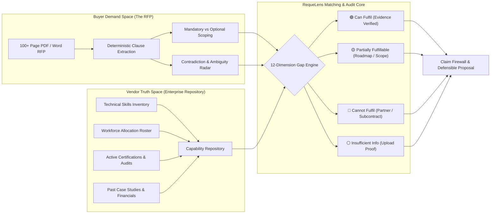

# REQUELENS
### *"Read. Reason. Verify. Propose."*

> **"AI writes it. AI audits it. Humans approve it."**  
> *Every requirement traced. Every risk surfaced. Every capability verified. Every claim defended.*

---

[](https://fastapi.tiangolo.com)
[](https://nextjs.org)
[](https://www.typescriptlang.org)
[](https://python.org)
[](https://tailwindcss.com)
[](LICENSE)

---

## 📑 Table of Contents

1. [Executive Overview & Core Vision](#-executive-overview--core-vision)
2. [The RFP Crisis: Why Generative AI Fails Alone](#-the-rfp-crisis-why-generative-ai-fails-alone)
3. [Dual-Sided Intelligence Paradigm](#-dual-sided-intelligence-paradigm)
4. [12 Core Comparison & Verification Dimensions](#-12-core-comparison--verification-dimensions)
5. [5 Advanced Enterprise Evaluation Vectors](#-5-advanced-enterprise-evaluation-vectors)
6. [Core Product Modules & Capabilities](#-core-product-modules--capabilities)
7. [System Architecture & 25-Step Pipeline](#-system-architecture--25-step-pipeline)
8. [Visual Tour & Interface Highlights](#-visual-tour--interface-highlights)
9. [Technology Stack](#-technology-stack)
10. [Repository Structure](#-repository-structure)
11. [Installation & Local Setup](#-installation--local-setup)
12. [Production Deployment Guide (Render)](#-production-deployment-guide-render)
13. [Test Suite & Verification](#-test-suite--verification)
14. [Design Decisions & Engineering Principles](#-design-decisions--engineering-principles)

---

## 🌟 Executive Overview & Core Vision

**REQUELENS** (Axiom RequeLens) is an enterprise-grade, evidence-first **RFP Intelligence, Capability Matching, and Proposal Engineering Platform**. 

Government agencies and Fortune 500 enterprises release Requests for Proposals (RFPs) spanning hundreds of pages of complex specifications, regulatory mandates, strict Service Level Agreements (SLAs), and severe contractual liability clauses. Traditionally, bid management teams spend weeks reading documents, cross-checking past projects, interviewing systems architects, and scrambling to write compliant responses under tight deadlines.

### What RequeLens Solves
Most generative AI tools treat proposal creation as a basic text-generation prompt:
```
RFP PDF ──> LLM Prompt ──> Unchecked, Hallucinated Proposal
```
This leads to catastrophic outcomes: invented performance figures, promised features the vendor doesn't own, overlooked cross-clause contradictions, and commitments that lead to liquidated damages or disqualification.

**RequeLens enforces a deterministic, dual-sided evidence chain:**
```
Buyer's RFP Mandates                Bidder's Verified Capabilities
   (PDF / Word)                         (Catalogs / Spreadsheets / Certs)
        │                                             │
        ▼                                             ▼
Page-Aware Parsing                             Capability Ingestion
  & Normalization                              & Validity Auditing
        │                                             │
        └──────────────────────┬──────────────────────┘
                               │
                               ▼
               Cross-Evaluation & Gap Engine
                  (12 Verification Vectors)
                               │
                               ▼
                 Strategic Solution Architecture
                               │
                               ▼
                16-Section Defensible Proposal
                               │
                               ▼
               Claim Firewall (Independent Audit)
                               │
                               ▼
             Human Review & Audited DOCX/PDF Export
```

---

## ⚠️ The RFP Crisis: Why Generative AI Fails Alone

Enterprise bidding is **high-stakes contract law**, not creative copywriting. When an organization signs a contract based on an RFP proposal, every commitment is legally binding.

| Risk Category | What Typical AI Tools Do | How RequeLens Solves It |
|---|---|---|
| **Hallucinated Features** | Claims the vendor supports features that don't exist in their codebase. | **Capability Matching Engine** verifies claims against uploaded internal proof documents. |
| **Contradictory Clauses** | Misses conflicting instructions across distant pages. | **Cross-Clause Contradiction Engine** flags mutually exclusive requirements with page provenance. |
| **Ambiguous Specifications** | Gloses over terms like *"high availability"* or *"ultra-fast"*. | **Ambiguity Detector** pinpoints missing numbers (RPS, RPO, RTO) and drafts RFIs. |
| **Timeline Feasibility** | Agrees blindly to an impossible 10-week delivery schedule. | **Delivery Estimator** benchmarks scope against historical delivery velocity with trade-off options. |
| **Expired Credentials** | Mentions ISO 27001 or AWS certs even if expired 2 years ago. | **Evidence Expiry Gate** verifies validity dates, preventing disqualified submissions. |
| **Unbacked Marketing Fluff** | Generates unverifiable assertions ("industry-leading security"). | **Proposal Claim Firewall** flags and isolates unsupported claims before export. |

---

## 🔄 Dual-Sided Intelligence Paradigm

Evaluating an RFP in a vacuum is only half the battle. A bid team must answer two fundamentally distinct questions:
1. **What is the buyer demanding?** (Extracted requirements, mandatory clauses, legal liabilities, SLA thresholds, timeline constraints).
2. **What can we actually deliver?** (Engineering skills, available unallocated headcount, active certifications, verified past projects, balance sheet solvency).



---

## 📊 12 Core Comparison & Verification Dimensions

RequeLens cross-examines the buyer's RFP clauses against the bidder's verified database across **12 systematic dimensions**:

```
 1. Technical Skills         5. Industry Domain         9. Financial Solvency
 2. Workforce Capacity       6. Tech Infrastructure    10. Delivery Feasibility
 3. Valid Certifications     7. Security & Compliance  11. Integration Depth
 4. Past Case Studies        8. Resource Availability  12. SLA & Maintenance
```

| No. | Resource / Dimension | What RequeLens Checks & Verifies | Evidence Required |
|:---:|:---|:---|:---|
| **1** | **Technical Skills** | Does the bidder possess deep, demonstrable expertise in the specific technologies required (e.g., Python, React, Kubernetes, AWS, PostgreSQL, Kafka)? | Capability catalogs, GitHub repos, technical whitepapers. |
| **2** | **Workforce Capacity** | Does the organization have the headcount, seniority distribution (Principal, Senior, Staff), and roles (Solution Architect, DevOps, QA) required to staff the team? | Workforce rosters, organizational charts, skill matrices. |
| **3** | **Active Certifications** | Does the company hold active, audit-verified certifications (AWS Partner, CKA, ISO 27001, SOC 2 Type II, PMP)? **Includes expiration gating.** | Official certificate PDFs, accreditation numbers, audit reports. |
| **4** | **Previous Projects** | Has the organization completed similar engagements of comparable scale, user volume, and architectural complexity? | Case studies, client reference letters, project closure memos. |
| **5** | **Industry Domain Experience** | Does the vendor have specialized industry domain experience (FinTech/Banking, Healthcare HIPAA, Defense, Public Sector, Telecom)? | Industry vertical case studies, regulatory compliance records. |
| **6** | **Technology Infrastructure** | Does the bidder maintain the required development, staging, testing, multi-cloud, and high-availability infrastructure? | Architecture topologies, data center SLAs, cloud tenancy proof. |
| **7** | **Compliance & Security** | Can the bidder prove adherence to ISO 27001 ISMS controls, SOC 2 Trust Services Criteria, GDPR/DPDP privacy workflows, and zero-trust RBAC? | Security policies, penetration test summaries, SOC 2 reports. |
| **8** | **Resource Availability** | Are the required specialists **actually unallocated and available** during the specific execution window, or already 100% committed to other projects? | Resource allocation schedules, bench reports, project end-dates. |
| **9** | **Financial Capability** | Can the bidder meet the buyer's annual turnover requirements, minimum net worth, bid bonds, and professional indemnity insurance coverage? | Audited balance sheets, insurance riders, bank solvency letters. |
| **10** | **Delivery Capability** | Can the vendor realistically hit the delivery milestones, sprint cycles, and go-live deadlines given historical velocity and scope size? | Historical project delivery logs, Jira velocity benchmarks. |
| **11** | **Integration Capability** | Does the vendor have proven experience integrating with legacy mainframes, ERPs (SAP, Oracle), CRMs (Salesforce), and third-party APIs? | API documentation, integration architectures, connector catalogs. |
| **12** | **Support & Maintenance** | Can the vendor provide 24/7/365 multi-tier support, defined SLA response/resolution windows (P1 < 15m), and disaster recovery guarantees? | SLA agreements, support team shift schedules, runbooks. |

---

## 🚀 5 Advanced Enterprise Evaluation Vectors

Beyond basic capability mapping, RequeLens incorporates five deep-tier evaluation vectors that separate winnable bids from operational disasters:

### A. Project Delivery History & Variance Analysis
- **The Problem**: Vendors routinely bid on 8-month schedules while their historical average for identical scopes is 14 months, leading to default notices and penalties.
- **RequeLens Engine**:
  - Compares RFP target duration, team size, and budget against empirical project archives.
  - Automatically flags timeline variance:  
    *Example: Buyer demands 8-month delivery. Historical case studies show an average delivery window of 6.5–7.2 months for 10-microservice architectures. Status: 🟢 Feasible with 15% buffer.*

### B. Financial Strength & Solvency Verification
- **The Problem**: Public sector and enterprise RFPs mandate financial thresholds (e.g., minimum turnover of \$50M, \$10M liability insurance). Submitting without verified proof leads to administrative disqualification.
- **RequeLens Engine**:
  - Parses balance sheet extracts, turnover metrics, bank guarantee capacities, and active insurance binders.
  - Flags gaps:  
    *Example: Buyer requires ₹50 Crore annual turnover and ₹10 Crore cyber liability insurance; verified company evidence confirms ₹65 Crore turnover and ₹15 Crore active policy. Status: 🟢 Compliant.*

### C. Real-Time Resource Allocation vs. Nominal Headcount
- **The Problem**: A vendor boasts "100 Kubernetes engineers" on their website, but 94 of them are locked into existing long-term multi-year contracts.
- **RequeLens Engine**:
  - Distinguishes between **total theoretical bench** and **actual deployable capacity** across the project's calendar timeline.
  - Exposes allocation deficits:  
    *Example: Project requires 6 senior AWS Cloud Architects starting Month 2. Database shows 20 on payroll, but only 2 available in Q1. Status: 🟡 Resource Constraint — Early Contractor Recruiting Required.*

### D. Security & Compliance Evidence Expiration Gating
- **The Problem**: Sales engineers attach outdated ISO certificates or expired penetration test reports, causing instant bid disqualification during procurement audit.
- **RequeLens Engine**:
  - Extracts and monitors validity dates, audit recency, and scope coverage.
  - Enforces hard expiration gating:  
    *Example: Vendor cites ISO 27001 certification. System inspects certificate expiry date (e.g., Expired October 15, 2024). RequeLens automatically excludes it, downgrades the score, and generates an alert to upload the renewed ISO certificate.*

### E. Technology Maturity & Production Hardening
- **The Problem**: Claiming "Kubernetes expertise" when the team has only run local Minikube clusters, while the RFP mandates multi-zone, active-active failover with zero-data-loss RPO.
- **RequeLens Engine**:
  - Evaluates operational maturity: CI/CD automation, disaster recovery test logs, telemetry (Prometheus/Datadog), and zero-downtime deployment patterns.
  - Discloses architectural caveats:  
    *Example: Buyer mandates Kubernetes multi-region failover. Vendor has single-region production evidence. Status: 🟡 Partially Fulfillable — Multi-region deployment requires dedicated architecture phase.*

---

## 🛠️ Core Product Modules & Capabilities

```
┌────────────────────────────────────────────────────────────────────────┐
│                          REQUELENS PLATFORM                            │
├─────────────────────┬───────────────────────┬──────────────────────────┤
│ 1. Document Parsing │ 2. Intelligence Core  │ 3. Capability Matching   │
│ • Page-Aware PDF    │ • Contradiction Radar │ • 12-Dimension Engine    │
│ • Word DOCX Tables  │ • Ambiguity Detector  │ • Document Ingestion     │
│ • Coordinate Anchor │ • Clarification RFIs  │ • Gap Dossier Generator  │
├─────────────────────┼───────────────────────┼──────────────────────────┤
│ 4. Solution Design  │ 5. Proposal Engine    │ 6. Verification & Export │
│ • Topology Matrix   │ • 16-Section Volume   │ • Claim Firewall         │
│ • Tech Stack Map    │ • Executive Summary   │ • Readiness Score (0-100)│
│ • Timeline Sizing   │ • Bid Disclaimers     │ • Audited DOCX & PDF     │
└─────────────────────┴───────────────────────┴──────────────────────────┘
```

### 1. Document Parsing with Page-Geometry Preservation
- Custom integration with **PyMuPDF (`fitz`)** and **`python-docx`**.
- Preserves exact page numbers, table cells, section headings, and bounding geometry.
- No lost footnotes, headers, or amendment attachments.

### 2. Requirement Intelligence & Extraction
- Identifies every obligation and classifies it: **Mandatory**, **Highly Desirable**, **Optional**.
- Extracts verbatim source text and assigns confidence scores.
- Maintains strict traceability: *every requirement is permanently anchored to its exact page number and excerpt*.

### 3. Cross-Clause Contradiction Engine
- Scans cross-document sections to catch mutually incompatible requirements:
  - *Page 17*: Mandates all databases must reside strictly on-premise behind corporate firewalls.
  - *Page 93*: Specifies managed AWS RDS Multi-AZ PostgreSQL with public API gateways.
- Generates side-by-side evidence comparisons and pre-formats procurement clarification questions.

### 4. Ambiguity Detector & Specification Quantifier
- Detects non-quantifiable criteria (*"high scalability"*, *"fast query response"*, *"enterprise-grade reliability"*).
- Outlines missing metrics (concurrent users, RPS, p99 latency thresholds, RPO/RTO targets).
- Suggests formal clarification addenda before submission.

### 5. Pre-Bid Clarification RFI Generator
- Automatically produces structured inquiries formatted for client procurement officers.
- Categorized by requirement ID, page number, contradiction reason, and recommended answer.
- Features **one-click copy-to-clipboard** for fast sales communication.

### 6. Company Capability Repository (`/capabilities`)
- Enterprise repository storing verified skills, case studies, workforce rosters, certifications, and compliance evidence.
- Multi-format ingestion supporting **CSV, XLSX, DOCX, and PDF**.
- Tracks expiration dates, verification statuses, and page citations.

### 7. RFP vs. Capability Gap Analysis Engine (`Check Capabilities`)
- Cross-matches RFP clauses against internal company proof records.
- Produces an **8-Column Deterministic Compliance Matrix**:
  1. `No.` 2. `Req ID` 3. `RFP Requirement & Citation` 4. `Required Specification` 5. `Available Capability` 6. `Status (Can Fulfil / Partial / Cannot / Insufficient)` 7. `Gap Remediation Action` 8. `Evidence Source Reference`
- Features **1-Click Compliance Dossier Copy** for proposal drafting.

### 8. Solution Architecture Synthesis
- Designs an engineered technical architecture customized to the RFP:
  - Microservices topology, data pipelines, API gateways, storage strategies, and security perimeters.
  - Strict tagging: **Required by Client**, **Proposed by Vendor**, or **Assumed Operational Baseline**.

### 9. Delivery Feasibility & Scenario Modeling
- Compares client timeline expectations against empirical delivery algorithms.
- Presents realistic **Option A (Full Scope)**, **Option B (Phased MVP)**, and **Option C (Accelerated Sprints)** trade-off models with delivery risk disclaimers.

### 10. Structured 16-Section Technical Proposal Generator
- Generates a complete, comprehensive, and defense-ready proposal covering:
  - Executive Summary, Scope Interpretation, Solution Architecture, Tech Stack Selection, Implementation Methodology, Team Structure, Quality Assurance, Security & Governance, SLAs, and Commercial Assumptions.

### 11. Proposal Claim Firewall (Independent AI Audit)
- An isolated verification engine audits the generated proposal text sentence by sentence into four strict classifications:
  - 🟢 **GROUNDED_REQUIREMENT**: Direct match to RFP requirement text with exact page provenance.
  - 🔵 **PROPOSED_DESIGN**: Engineered architectural solution clearly marked as vendor proposal.
  - 🟡 **ASSUMPTION**: Stated operational pre-requisite requiring buyer sign-off.
  - 🔴 **UNSUPPORTED_CLAIM**: Unsubstantiated marketing claim; automatically proposes an evidence-based correction.

### 12. Deterministic Proposal Readiness Score (0–100)
- Mathematical index calculated without subjective LLM bias:
  $$\text{Score} = w_1(\text{Coverage}) + w_2(\text{Clarity}) + w_3(\text{Grounding}) + w_4(\text{Traceability}) + w_5(\text{Risk Mitigation})$$
- Never promises a fake "win rate"; measures internal audit completeness and proposal rigor.

### 13. Interactive Document Viewer with Provenance Highlighting
- Embedded PDF viewer linked directly to extracted requirements.
- Clicking any requirement instantly jumps to the exact source page with evidence highlighted.

### 14. 60fps Canvas Scroll Animation Engine
- Custom landing page visualizer rendering 140+ cinematic frames at high frame rates.
- GPU-accelerated canvas compositing, exponential lerp easing, zero layout shift, and background frame preloading.

---

## 🏗️ System Architecture & 25-Step Pipeline

```mermaid
sequenceDiagram
    autonumber
    actor User as Bid Manager
    participant UI as Next.js 14 Frontend
    participant API as FastAPI Backend
    participant DP as Document Parser (fitz/docx)
    participant Core as Pipeline Orchestrator
    participant CapEng as Capability Engine
    participant LLM as LLM Provider (Gemini/OpenAI)
    participant FW as Claim Firewall
    participant DB as SQLite / Repository

    User->>UI: Upload RFP (PDF/DOCX)
    UI->>API: POST /api/projects/upload
    API->>Core: Launch Background Execution Pipeline

    rect rgb(20, 20, 25)
        note over Core,DP: Phase 1: Document Processing & Extraction
        Core->>DP: Parse Pages & Chunk Geometry
        DP-->>Core: Page-Anchored Semantic Chunks
        Core->>LLM: Extract & Normalize Requirements
        LLM-->>Core: Structured Requirements (with Page Citations)
        Core->>Core: Detect Contradictions, Ambiguities & Risks
        Core->>Core: Generate Clarification Questions
    end

    rect rgb(25, 25, 20)
        note over Core,CapEng: Phase 2: Dual-Sided Capability Audit
        Core->>CapEng: Query Enterprise Capability Repository
        CapEng->>CapEng: Cross-Match 12 Dimensions & Expiry Gates
        CapEng-->>Core: 8-Column Gap Matrix & Compliance Score
    end

    rect rgb(20, 25, 25)
        note over Core,LLM: Phase 3: Architecture & Proposal Generation
        Core->>LLM: Synthesize Solution Architecture & Tech Stack
        Core->>Core: Calculate Delivery Feasibility & Milestones
        Core->>LLM: Generate 16-Section Technical Proposal
        Core->>Core: Build End-to-End Traceability Matrix
    end

    rect rgb(25, 20, 25)
        note over Core,FW: Phase 4: Independent Verification & Audit
        Core->>FW: Audit Proposal against Extracted Evidence
        FW-->>Core: Claim Classifications (Grounded/Proposed/Assumption/Unsupported)
        Core->>Core: Calculate Deterministic Proposal Readiness Score (0-100)
    end

    Core->>DB: Persist Full Project State
    API-->>UI: Streaming Pipeline Progress (0% -> 100%)
    UI->>User: Display Executive Briefing & Audited Proposal Workspace
```



---

## 📸 Visual Tour & Interface Highlights

### 1. Executive Intelligence Briefing
*The command center displaying Proposal Readiness, 3 sorted mandate pillars, expandable verbatim scope breakdown, executive observations, and the 6 core KPI metrics cards.*


---

### 2. Enterprise Capability Intelligence Repository
*Centralized company database tracking active vs. expired certifications, verified project history, workforce allocations, technical skill domains, and evidence grounding.*


---

### 3. RFP vs. Capability Matching Matrix
*The 8-column deterministic matrix comparing buyer clauses to company capabilities, displaying fulfillment status, gap remediation actions, and exact citations.*


---

### 4. Cinematic 60fps Landing Experience
*Interactive, GPU-accelerated landing page highlighting RequeLens' evidence-first philosophy, comparison breakdown, and live demo access.*


---

## 💻 Technology Stack

```
Frontend Architecture                     Backend Architecture
┌───────────────────────────────┐        ┌──────────────────────────────┐
│ • Next.js 14 (App Router)     │        │ • Python 3.11+               │
│ • React 18 + TypeScript       │        │ • FastAPI (Asynchronous REST)│
│ • Tailwind CSS                │        │ • Pydantic v2 (Validation)   │
│ • HTML5 Canvas (60fps Scroll) │  HTTP  │ • PyMuPDF (fitz) + pypdf     │
│ • Lucide Icons                │◄──────►│ • python-docx + ReportLab    │
│ • Cormorant Garamond Serif    │        │ • SQLite (Repo Abstraction)  │
│ • JetBrains Mono              │        │ • Google Gemini 2.5 Flash    │
│ • Plus Jakarta Sans           │        │ • OpenAI GPT-4o Support      │
└───────────────────────────────┘        └──────────────────────────────┘
```

---

## 📁 Repository Structure

```
AXIOM-REQUELENS/
├── backend/
│   ├── api/
│   │   └── main.py                     # FastAPI REST API endpoints
│   ├── database/
│   │   ├── db.py                       # SQLite repository & schema migrations
│   │   └── reclens.db                  # Local database storage
│   ├── exports/
│   │   └── export_service.py           # DOCX & PDF proposal generators
│   ├── parsers/
│   │   ├── document_parser.py          # Page-aware PDF & DOCX text/geometry extraction
│   │   └── document_chunker.py         # Semantic chunking preserving page metadata
│   ├── schemas/
│   │   └── models.py                   # Pydantic models for requirements, risks, proposals
│   ├── services/
│   │   ├── ambiguity_detector.py       # Identifies unmeasurable metrics & missing criteria
│   │   ├── capability_engine.py        # 12-dimension matching & spreadsheet/document parser
│   │   ├── claim_firewall.py           # Proposal claim verification & classification
│   │   ├── contradiction_detector.py   # Cross-clause contradiction scanner
│   │   ├── delivery_estimator.py       # Timeline feasibility & milestone estimation
│   │   ├── llm_provider.py             # LLM provider abstraction (Gemini / OpenAI / Fallback)
│   │   ├── pipeline_orchestrator.py    # 25-step execution pipeline engine
│   │   ├── proposal_generator.py       # 16-section technical proposal generation
│   │   ├── readiness_scorer.py         # Deterministic Proposal Readiness Index
│   │   ├── requirement_normalizer.py   # Normalization, deduplication & classification
│   │   ├── solution_architect.py       # Architecture topology & stack design
│   │   └── traceability_engine.py      # End-to-end traceability matrix builder
│   └── uploads/                        # Temporary document storage for processing
├── docs/
│   └── images/                         # Project screenshots and diagrams
├── frontend1/
│   ├── public/
│   │   ├── images/                     # Logos and assets
│   │   └── requelens-frames/           # Canvas animation frame sequence
│   ├── src/
│   │   ├── app/
│   │   │   ├── capabilities/           # Enterprise Capability Intelligence Repository
│   │   │   ├── projects/               # Projects listing & management
│   │   │   ├── projects/[id]/          # Proposal workspace, audits & capability comparison
│   │   │   ├── layout.tsx              # Root layout & font configuration
│   │   │   └── page.tsx                # Cinematic landing page
│   │   ├── components/
│   │   │   ├── RecLensScrollExperience.tsx # 60fps Canvas scroll animation engine
│   │   │   ├── Navbar.tsx              # Global navigation bar
│   │   │   └── UploadModal.tsx         # Drag-and-drop RFP ingestion modal
│   │   └── lib/
│   │       └── api.ts                  # Typed client for backend REST API
│   ├── package.json
│   └── tailwind.config.js              # Custom color palette (Obsidian, Bronze, Gold)
├── tests/
│   └── test_capability_suite.py        # Unit & integration tests for capability engine
├── sample-data/
│   └── demo_project.py                 # Seed datasets for demonstration
├── .env.example                        # Template environment variables
├── requirements.txt                    # Python dependencies
└── README.md                           # Documentation
```

---

## ⚡ Installation & Local Setup

### 1. Prerequisites
- **Node.js**: v18.0.0 or higher
- **Python**: v3.11 or higher
- **Git**

### 2. Clone the Repository
```bash
git clone https://github.com/your-username/AXIOM-REQUELENS.git
cd AXIOM-REQUELENS
```

### 3. Backend Setup
```bash
# Navigate to project root
# Create and activate Python virtual environment
python -m venv venv

# Windows
.\venv\Scripts\activate

# macOS / Linux
source venv/bin/activate

# Install dependencies
pip install -r requirements.txt

# Create environment configuration
cp .env.example .env
```

Edit `.env` to supply your AI API key:
```env
# AI Provider Configuration
LLM_PROVIDER=gemini                     # Options: gemini | openai | fallback
GEMINI_API_KEY=your_gemini_api_key_here # Or OPENAI_API_KEY=your_key_here
PORT=8000
```

Start the backend API server:
```bash
uvicorn backend.api.main:app --host 127.0.0.1 --port 8000 --reload
```
*API docs will be available at `http://127.0.0.1:8000/docs`.*

### 4. Frontend Setup
Open a second terminal window:
```bash
cd frontend1

# Install frontend dependencies
npm install

# Start Next.js development server
npm run dev
```
Open `http://localhost:3000` in your browser.

---

## ☁️ Production Deployment Guide (Render)

The project is pre-configured for seamless production hosting on **Render**:

### A. Backend Web Service (FastAPI)
1. **Repository**: Select your GitHub repo.
2. **Environment**: `Python 3`
3. **Root Directory**: `.` (leave as root)
4. **Build Command**:
   ```bash
   pip install -r requirements.txt
   ```
5. **Start Command**:
   ```bash
   uvicorn backend.api.main:app --host 0.0.0.0 --port $PORT
   ```
6. **Environment Variables**:
   - `LLM_PROVIDER`: `gemini`
   - `GEMINI_API_KEY`: `<your-api-key>`
   - `PYTHON_VERSION`: `3.11.9`

### B. Frontend Web Service (Next.js)
1. **Repository**: Select the same GitHub repo.
2. **Environment**: `Node`
3. **Root Directory**: `frontend1` *(Crucial: must point to frontend1)*
4. **Build Command**:
   ```bash
   npm install && npm run build
   ```
5. **Start Command**:
   ```bash
   npm start
   ```
6. **Environment Variables**:
   - `NEXT_PUBLIC_API_URL`: `https://your-backend-service.onrender.com`
   - `NODE_VERSION`: `20.x`

---

## 🧪 Test Suite & Verification

The platform features an automated test suite verifying capability parsing, 8-column matrix generation, and database persistence:

```bash
# Run test suite from repository root
python -m unittest tests/test_capability_suite.py
```

### What Tests Cover
- ✅ **Parsing Integrity**: Verifies CSV, XLSX, DOCX, and PDF parsing without data loss.
- ✅ **Comparison Columns**: Validates that all 8 comparison columns (`req_id`, `rfp_requirement`, `required_specification`, `available_capability`, `status`, `gap_action`, `rfp_source`, `organisation_source`) are present in output.
- ✅ **Category Classification**: Tests accuracy across *Can Fulfil*, *Partially Fulfillable*, *Cannot Fulfil*, and *Insufficient Information*.
- ✅ **Repository Operations**: Validates capability document storage, retrieval, and comparison payload caching in SQLite.

---

## 📐 Design Decisions & Engineering Principles

### 1. Zero-Hallucination Grounding
Every extracted requirement stores its exact page number and verbatim excerpt. The system never invents clauses or cites nonexistent pages.

### 2. No Fake "Win Probability"
Generic proposal generators display arbitrary "Win Probability: 89%" numbers. RequeLens explicitly rejects this. Our **Proposal Readiness Index (0–100)** is an objective, deterministic audit score measuring requirement coverage, evidence citation completeness, risk resolution, and capability alignment.

### 3. Clear Separation of Claim Truth
Through the **Claim Firewall**, every sentence in a generated proposal is explicitly classified:
- Client requirement vs. Vendor engineered design vs. Contingent operational assumption vs. Unsupported claim.

### 4. Human-in-the-Loop Authority
AI accelerates reading, cross-checking, and drafting; experienced bid managers, systems architects, and legal officers have final approval over all deliverables.

---

## 📄 License

This project is licensed under the MIT License — see the [LICENSE](LICENSE) file for details.

---

<div align="center">
  <sub>Engineered with precision for enterprise bid teams. Built for Hackathon Final.</sub><br>
  <strong>REQUELENS • Read. Reason. Verify. Propose.</strong>
</div>
